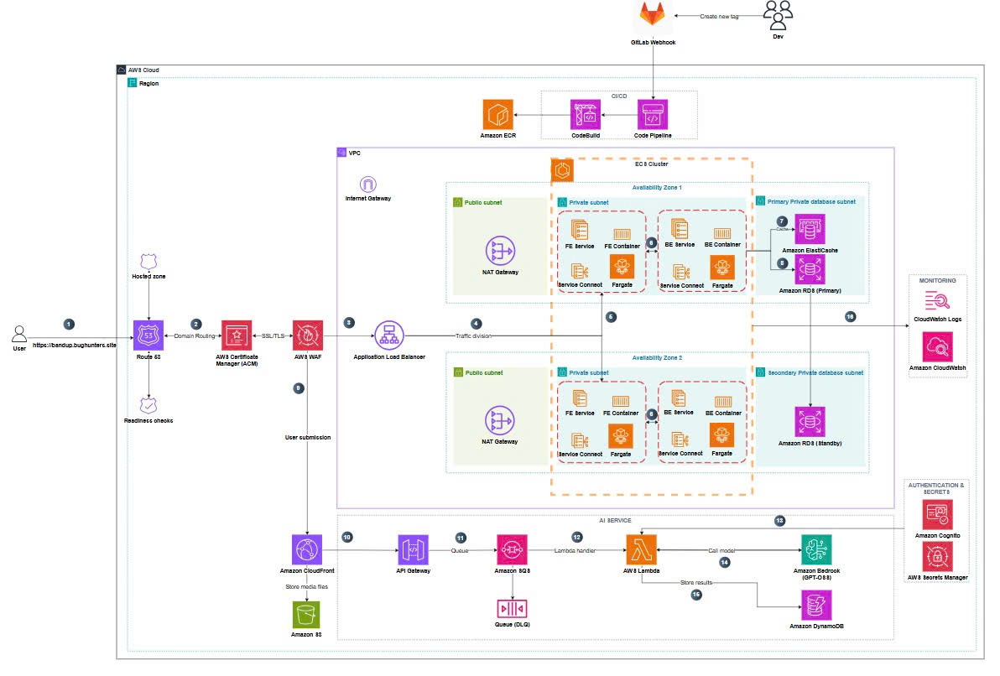

<div align="center">
  <br />
  <h1>🎓 IELTS Trial Test Platform</h1>
  <p>
    A modern, open-source platform that provides realistic IELTS practice tests with automatic scoring, detailed analytics, and personalized feedback for learners worldwide.
  </p>
  <p>
    <a href="https://github.com/Ojt-BugHunters/band-up/stargazers"></a>
    <a href="https://github.com/Ojt-BugHunters/band-up/network/members"></a>
    <a href="https://github.com/Ojt-BugHunters/band-up/issues"></a>
    <a href="https://github.com/Ojt-BugHunters/band-up/blob/main/LICENSE"></a>
  </p>
  <p>
    <a href="https://github.com/Ojt-BugHunters/band-up/actions"></a>
    <a href="https://github.com/Ojt-BugHunters/band-up/actions"></a>
    <a href="#"></a>
  </p>
</div>

---

## 📑 Table of Contents

- [📑 Table of Contents](#-table-of-contents)
- [🌟 About The Project](#-about-the-project)
  - [✨ Key Features](#-key-features)
  - [🛠️ Built With](#️-built-with)
- [🚀 Getting Started](#-getting-started)
  - [🧰 Prerequisites](#-prerequisites)
- [⚙️ Installation Guide (Docker Compose Setup)](#️-installation-guide-docker-compose-setup)
  - [🧩 Step 1 — Create Environment Files](#-step-1--create-environment-files)
    - [**1 `.env` (root-level for Compose)**](#1-env-root-level-for-compose)
    - [**2 `.env.backend` (in folder backend)**](#2-envbackend-in-folder-backend)
    - [**3 `.env.frontend` (in folder frontend)**](#3-envfrontend-in-folder-frontend)
  - [🐳 Step 2 — Pull Docker Images](#-step-2--pull-docker-images)
  - [🚀 Step 3 — Start the Application](#-step-3--start-the-application)
  - [🌐 Step 4 — Verify URLs](#-step-4--verify-urls)
- [☁️ AWS Deployment](#️-aws-deployment)
  - [AWS Services Used](#aws-services-used)
  - [Architecture Diagram](#architecture-diagram)
- [📖 Usage](#-usage)
- [🗺️ Roadmap](#️-roadmap)
- [🤝 Contributing](#-contributing)
- [📄 License](#-license)
- [📧 Contact](#-contact)

---

## 🌟 About The Project

The **IELTS Trial Test Platform** is a comprehensive web-based solution designed to help students prepare for the IELTS exam through realistic practice tests. The platform simulates the actual IELTS testing environment and provides instant feedback, detailed analytics, and personalized study recommendations.

### ✨ Key Features

- **🎯 Realistic Practice Tests** - Full-length IELTS tests covering all four skills: Listening, Reading, Writing, and Speaking
- **🤖 Automatic Scoring** - AI-powered evaluation system for Reading and Listening sections with instant results
- **📊 Detailed Analytics** - Comprehensive performance tracking and progress visualization
- **💡 Personalized Feedback** - Tailored recommendations based on individual performance patterns
- **🔐 Secure Authentication** - OAuth2 integration with Google login and JWT-based security
- **💳 Payment Integration** - VNPay integration for premium features and test packages
- **📧 Email Notifications** - Automated email system for test results and updates
- **☁️ Cloud Storage** - AWS S3 and CloudFront integration for secure and fast content delivery
- **📱 Responsive Design** - Mobile-friendly interface for learning on any device
- **🌐 Multi-language Support** - Interface available in multiple languages

### 🛠️ Built With

**Frontend:**
- [React.js](https://reactjs.org/) - Modern UI library for building interactive interfaces
- [TypeScript](https://www.typescriptlang.org/) - Type-safe JavaScript development
- [Tailwind CSS](https://tailwindcss.com/) - Utility-first CSS framework
- [Redux Toolkit](https://redux-toolkit.js.org/) - State management
- [React Query](https://tanstack.com/query/latest) - Data fetching and caching

**Backend:**
- [Spring Boot](https://spring.io/projects/spring-boot) - Java-based backend framework
- [Spring Security](https://spring.io/projects/spring-security) - Authentication and authorization
- [Spring Data JPA](https://spring.io/projects/spring-data-jpa) - Database access layer
- [PostgreSQL](https://www.postgresql.org/) - Relational database
- [Redis](https://redis.io/) - Caching and session management
- [JWT](https://jwt.io/) - Token-based authentication

**DevOps & Cloud:**
- [Docker](https://www.docker.com/) - Containerization
- [Docker Compose](https://docs.docker.com/compose/) - Multi-container orchestration
- [AWS](https://aws.amazon.com/) - Cloud infrastructure
- [GitHub Actions](https://github.com/features/actions) - CI/CD pipelines

---

## 🚀 Getting Started

To get a local copy up and running, follow these simple steps.

### 🧰 Prerequisites

Make sure you have the latest version of:

* **Docker** — [Install Docker](https://www.docker.com/get-started)
* **Docker Compose** — [Install Docker Compose](https://docs.docker.com/compose/install/)

---

## ⚙️ Installation Guide (Docker Compose Setup)

This guide will help you set up the IELTS Trial Test Platform locally using Docker Compose.

---

### 🧩 Step 1 — Create Environment Files

We use three environment files to separate configuration clearly.

#### **1 `.env` (root-level for Compose)**

Create this file in the root folder:

```.env
# ===============================
# 🌐 Global Configuration
# ===============================

# Docker registry (where your images are stored)
REGISTRY=your-dockerhub-username

# Image tags for backend & frontend
BACKEND_TAG=latest
FRONTEND_TAG=latest

# ===============================
# ⚙️ Ports
# ===============================
# Change these if the ports are already used on your local machine
BACKEND_PORT=8080
FRONTEND_PORT=3000
POSTGRES_PORT=5433
REDIS_PORT=6379

# ===============================
# 🧩 Docker Network & Volumes
# ===============================
NETWORK_NAME=ielts-trial-network

PG_VOL=ielts-postgres
REDIS_VOL=ielts-redis

# ===============================
# 🗃️ Database Configuration
# ===============================
PG_USER=postgres
PG_PASS=postgres
PG_DB=ielts_trial_test

# ===============================
# 🧠 Redis Configuration
# ===============================
REDIS_PASSWORD=

# ===============================
# 🔒 Backend API & CORS
# ===============================
# URL for frontend to call backend API
API_URL=http://backend:${BACKEND_PORT}

# Allowed origin for CORS
CORS_FRONTEND_ORIGIN=http://localhost:${FRONTEND_PORT}

# ===============================
# ☁️ CloudFront or Key Paths (optional)
# ===============================
# Adjust these paths according to your local machine setup.
CLOUDFRONT_PRIVATE_KEY_HOST_PATH=/path/to/your/private_key.pem
CLOUDFRONT_PRIVATE_KEY_CONTAINER_PATH=/run/keys/private_key.pem
```

#### **2 `.env.backend` (in folder backend)**

```.env.backend
# ===============================
# 🌐 Application Configuration
# ===============================
SPRING_APPLICATION_NAME=Band-Up
SPRING_JPA_HIBERNATE_DDL_AUTO=update

# ===============================
# 🔑 JWT Configuration
# ===============================
# Keys used for signing and refreshing tokens
JWT_REFRESHKEY=your-refresh-key-base64
JWT_REFRESHEXPIRATION=2592000000    # 30 days in ms
JWT_ACCESSKEY=your-access-key-base64
JWT_ACCESSEXPIRATION=900000          # 15 minutes in ms

# ===============================
# 🔐 OAuth2 Google Login
# ===============================
# Replace with credentials from Google Cloud Console
SPRING_SECURITY_OAUTH2_CLIENT_REGISTRATION_GOOGLE_CLIENT_ID=your-google-client-id
SPRING_SECURITY_OAUTH2_CLIENT_REGISTRATION_GOOGLE_CLIENT_SECRET=your-google-client-secret
SPRING_SECURITY_OAUTH2_CLIENT_REGISTRATION_GOOGLE_SCOPE=openid,profile,email

# ===============================
# ☁️ AWS S3 + CloudFront
# ===============================
AWS_ACCESS_KEY_ID=your-aws-access-key-id
AWS_SECRET_ACCESS_KEY=your-aws-secret-access-key
AWS_REGION=ap-southeast-1
AWS_S3_BUCKET=your-bucket-name
CLOUDFRONT_KEYPAIR_ID=your-cloudfront-keypair-id
CLOUDFRONT_DOMAIN=your-cloudfront-domain.cloudfront.net
CLOUDFRONT_PRIVATE_KEY_PATH=/app/private_key.pem

# ===============================
# 💳 VNPay Configuration
# ===============================
VNP_URL=https://sandbox.vnpayment.vn/paymentv2/vpcpay.html
VNP_SECRET=your-vnp-secret-key
VNP_TMNCODE=your-vnp-merchant-code

# ===============================
# 📧 Mail Configuration (SMTP)
# ===============================
SPRING_MAIL_HOST=smtp.gmail.com
SPRING_MAIL_PORT=587
SPRING_MAIL_PROPERTIES_MAIL_SMTP_AUTH=true
SPRING_MAIL_PROPERTIES_MAIL_STARTTLS_ENABLE=true
SPRING_MAIL_USERNAME=your-email@example.com
SPRING_MAIL_PASSWORD=your-app-password

# ===============================
# 🔗 URLs
# ===============================
FRONTEND_URL=http://localhost:3000
BACKEND_URL=http://localhost:8080
```

#### **3 `.env.frontend` (in folder frontend)**

```.env.frontend
API_URL=http://localhost:8080/api
```

---

### 🐳 Step 2 — Pull Docker Images

Navigate to the root folder and pull the images:

```bash
docker compose pull
```

---

### 🚀 Step 3 — Start the Application

Start all services in detached mode:

```bash
docker compose up -d
```

Check the status of all containers:

```bash
docker compose ps
```

---

### 🌐 Step 4 — Verify URLs

Once all containers are running, access the following services:

| Service | URL | Description |
|---------|-----|-------------|
| 🖥️ Frontend | [http://localhost:3000](http://localhost:3000) | User interface |
| ⚙️ Backend API | [http://localhost:8080/swagger-ui/index.html](http://localhost:8080/swagger-ui/index.html) | REST API documentation |
| 🗃️ PostgreSQL | `localhost:5433` | Database (use a client like pgAdmin) |
| 🧠 Redis | `localhost:6379` | Cache server |

---

## ☁️ AWS Deployment

The IELTS Trial Test Platform is deployed on AWS using a scalable and secure architecture.

### AWS Services Used

| Service | Purpose | Configuration |
|---------|---------|---------------|
| **EC2** | Application hosting | Auto-scaling group with t3.medium instances |
| **RDS (PostgreSQL)** | Database | Multi-AZ deployment for high availability |
| **ElastiCache (Redis)** | Caching & sessions | Redis cluster mode enabled |
| **S3** | Static assets & test content | Versioning enabled, encrypted at rest |
| **CloudFront** | CDN for content delivery | Global edge locations, signed URLs for security |
| **ALB** | Load balancing | Application Load Balancer with SSL/TLS |
| **Route 53** | DNS management | Custom domain with health checks |
| **VPC** | Network isolation | Private subnets for backend, public for ALB |
| **IAM** | Access management | Role-based access control |
| **CloudWatch** | Monitoring & logging | Custom metrics and alarms |
| **Secrets Manager** | Secure credential storage | Automatic rotation enabled |
| **ACM** | SSL certificates | Free SSL/TLS certificates |

### Architecture Diagram




**Key Architecture Features:**
- **High Availability**: Multi-AZ deployment for RDS and ElastiCache
- **Scalability**: Auto-scaling groups for both frontend and backend
- **Security**: VPC isolation, private subnets, security groups, and IAM roles
- **Performance**: CloudFront CDN with edge caching, Redis for application caching
- **Reliability**: Health checks, automated backups, and disaster recovery
- **Monitoring**: CloudWatch dashboards with custom metrics and alarms

---

## 📖 Usage

Detailed usage documentation will be available soon. Stay tuned!

---

## 🗺️ Roadmap

- [ ] AI-powered Speaking evaluation
- [ ] AI-powered Writing assessment with detailed feedback
- [ ] Mobile application (iOS & Android)
- [ ] Integration with additional payment gateways
- [ ] Gamification features (badges, leaderboards)
- [ ] Live tutoring sessions
- [ ] Study group features

---

## 🤝 Contributing

Contributions are what make the open-source community such an amazing place to learn, inspire, and create. Any contributions you make are **greatly appreciated**.

1. Fork the Project
2. Create your Feature Branch (`git checkout -b feature/AmazingFeature`)
3. Commit your Changes (`git commit -m 'Add some AmazingFeature'`)
4. Push to the Branch (`git push origin feature/AmazingFeature`)
5. Open a Pull Request

---

## 📄 License

Distributed under the MIT License. See `LICENSE` file for more information.

---

## 📧 Contact

Project Link: [https://github.com/your-username/ielts-trial-test](https://github.com/your-username/ielts-trial-test)

---

<div align="center">
  <p>Made with ❤️ for IELTS learners worldwide</p>
  <p>⭐ Star this repo if you find it helpful!</p>
</div>

